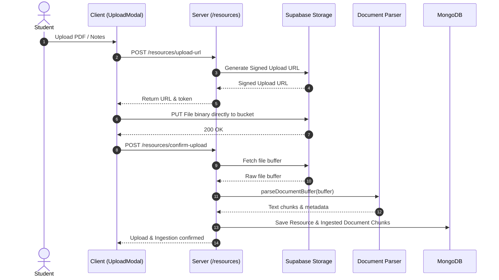
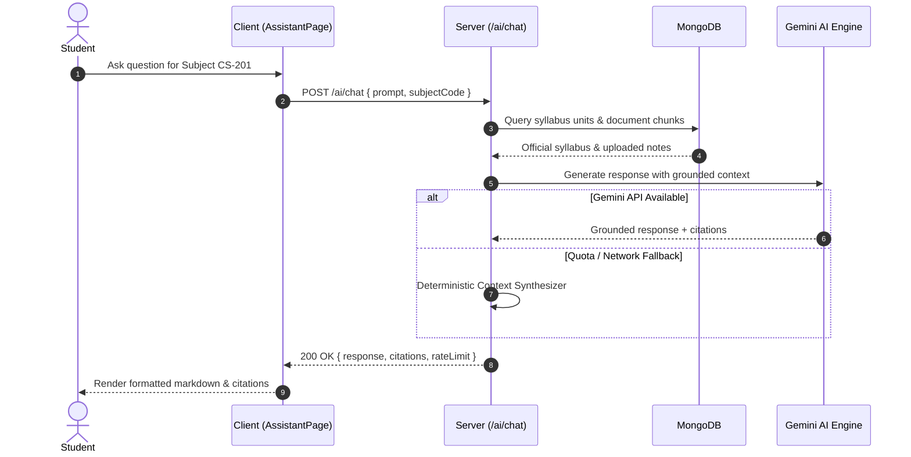

# Syllabix — AI-Powered Academic Knowledge & Collaboration Platform

> An intelligent, university-centric study ecosystem engineered for structured curriculum discovery, real-time peer collaboration, grounded AI study assistance, and adaptive spaced-repetition flashcards.

---

## Table of Contents
1. [Project Overview & Vision](#project-overview--vision)
2. [Key Capabilities](#key-capabilities)
3. [Technology Stack](#technology-stack)
4. [System Architecture](#system-architecture)
5. [Repository Structure](#repository-structure)
6. [Data Flow & Mermaid Architecture](#data-flow--mermaid-architecture)
7. [API Overview & Routes](#api-overview--routes)
8. [Database Schema & Collections](#database-schema--collections)
9. [Local Development Setup](#local-development-setup)
10. [Testing & Verification](#testing--verification)
11. [Security Practices](#security-practices)
12. [Roadmap & Contribution Guidelines](#roadmap--contribution-guidelines)

---

## Project Overview & Vision

University education often suffers from fragmented academic resources, inaccessible course syllabi, unverified notes, and isolated exam preparation. **Syllabix** bridges this gap by unifying:
1. **Curriculum-Grounded AI Study Assistance:** Generative and retrieval-augmented summaries, contextual Q&A, and practice assessments grounded in official institutional course outlines.
2. **Real-Time Student Collaboration:** Collaborative study rooms, mentor booking, and peer Q&A communities with verified answer recognition.
3. **Cognitive Spaced Repetition:** SuperMemo-2 (SM-2) flashcard generation directly synthesized from lecture units.
4. **Institutional Quality & Gamification:** Student contribution badges, reputation scoring, and verified academic resource coverage.

---

## Key Capabilities

- **Academic Syllabus Directory:** Interactive multi-dimensional exploration of engineering branches (CSE, IT, ECE, ME, CE), semesters (1–8), courses, dynamic subject pills, and unit-by-unit curriculum outlines.
- **AI Study Assistant (Gemini Engine):** Multi-turn conversational interface with scanned lecture note parsing, document ingestion, and grounded citations powered by canonical `gemini-1.5-flash` and `text-embedding-004`.
- **Details Drawer (Study Suite):** Instant high-yield unit summaries, interactive 5-question mock exams, direct syllabus contribution actions, and instant flashcard deck creation.
- **Spaced Repetition Flashcards:** SuperMemo SM-2 spaced-repetition engine calculating ease factors ($EF \ge 1.3$), review intervals ($1 \to 6 \to \text{round}(I \times EF)$), and due dates directly synthesized from lecture units.
- **Collaborative Study Rooms:** Real-time peer study spaces with Supabase Realtime Channels, live peer presence tracking, group chat, and resource attachments.
- **Academic Mentorship:** Search and connect with top-tier departmental mentors, schedule 1-on-1 review sessions with rich instant topic quote confirmations, and track requests.
- **Community Discussions:** Peer forum supporting upvotes, accepted answers with resolution status indicators, subject tagging, and 15 reputation points attribution.
- **Institutional Analytics:** Dean and departmental view tracking verified syllabus coverage, student engagement, and resource health.

---

## Technology Stack

### Frontend
- **Framework:** React 18 (SPA) with Vite 6
- **Routing:** React Router DOM v7
- **Styling & Tokens:** Tailwind CSS with modern custom Indigo design tokens
- **Animations & Scrolling:** Framer Motion, GSAP entrance animations, and Lenis smooth inertial scrolling
- **Icons:** Lucide React

### Backend
- **Runtime:** Node.js 20+
- **Framework:** Express 4 (TypeScript)
- **Validation:** Zod schemas for request validation
- **Security:** Helmet, CORS, signed URL validation, and rate limiting
- **Logging:** Morgan

### Database & Storage
- **Primary Database:** MongoDB with Mongoose 8 ORM
- **Authentication:** Supabase Authentication (JWT) + Local Development Demo Sessions
- **Document Storage:** Supabase Storage (S3-compatible private buckets with signed URLs)
- **Realtime:** Supabase Realtime Channels (PostgreSQL / WebSockets)

### AI & Semantic Retrieval
- **LLM Engine:** Google Gemini API (`gemini-2.5-flash` / `@google/genai`)
- **Semantic Embeddings:** Gemini Vector Embeddings + In-Memory Cosine Similarity Ranking
- **Document Parsing:** `pdf-parse` v2 and UTF-8 multi-chunk text extractors

---

## System Architecture

```
┌─────────────────────────────────────────────────────────────┐
│                       Client (Vite / React)                 │
│  - DirectoryPage   - AssistantPage    - DiscussionsPage     │
│  - StudyRoomsPage  - MentorshipPage   - AnalyticsPage       │
│  - DetailsDrawer   - FlashcardDeck    - CanvasBackground    │
└──────────────────────────────┬──────────────────────────────┘
                               │ HTTP / JSON API (port 5001)
                               ▼
┌─────────────────────────────────────────────────────────────┐
│                  Server API (Node.js / Express)             │
│  - Auth Middleware (/auth/supabase)                         │
│  - Controllers: ai, resources, discussions, studyGroups     │
│  - Services: aiService, documentParser, storageService       │
└──────────────┬───────────────────────────────┬──────────────┘
               │                               │
               ▼                               ▼
┌──────────────────────────────┐ ┌────────────────────────────┐
│      MongoDB Database        │ │    Supabase Cloud Service  │
│ - Subjects     - Resources   │ │ - Supabase Auth (JWT)      │
│ - Discussions  - Comments    │ │ - Supabase Storage (S3)    │
│ - StudyGroups  - Flashcards  │ │ - Supabase Realtime        │
└──────────────────────────────┘ └────────────────────────────┘
```

---

## Repository Structure

```
Syllabix/
├── client/                     # Frontend Vite + React application
│   ├── src/
│   │   ├── components/         # Reusable UI widgets, Navbar, Drawers, Modals
│   │   │   └── 3d/             # Three.js / Canvas particle constellation background
│   │   ├── context/            # Global React Contexts (AuthContext)
│   │   ├── hooks/              # Custom React hooks (useBodyScrollLock, useRealtime)
│   │   ├── lib/                # API wrapper (api.ts) & Supabase client
│   │   ├── pages/              # Primary route pages (Assistant, Directory, etc.)
│   │   ├── types/              # TypeScript contracts and domain models
│   │   ├── tokens.css          # Semantic design tokens (Indigo palette)
│   │   └── App.tsx             # Root routing, Lenis scroll, and global modals
│   ├── package.json
│   └── vite.config.ts
├── server/                     # Backend Express + TypeScript application
│   ├── src/
│   │   ├── config/             # Environment, DB, and Supabase client configs
│   │   ├── controllers/        # Express handlers (ai, auth, resource, etc.)
│   │   ├── middleware/         # Security, auth, and error-handling middlewares
│   │   ├── models/             # Mongoose schemas & TypeScript interfaces
│   │   ├── routes/             # Versioned REST router (/api/v1)
│   │   ├── services/           # Gemini AI, documentParser, Supabase storage
│   │   └── index.ts            # Application bootstrap and port management
│   ├── package.json
│   └── tsconfig.json
├── tests/                      # End-to-end and integration verification suites
│   └── e2e-ai-verification.ts  # 4-tier verification test harness (70 tests)
├── docs/                       # Technical specs and architecture records
├── .github/                    # CI workflows and issue templates
├── package.json                # Root workspace orchestration
├── MEMORY.md                   # Persistent engineering context
└── README.md                   # Project documentation
```

---

## Data Flow & Mermaid Architecture

### 1. Document Upload & Ingestion Flow


### 2. Grounded AI Assistant Request Flow


---

## API Overview & Routes

Base URL: `http://localhost:5001/api/v1`

| Module | Method | Endpoint | Description | Auth Required |
|---|---|---|---|---|
| **Health** | `GET` | `/health` | System liveness & dependency readiness | No |
| **Subjects** | `GET` | `/subjects` | Get curriculum subjects with filters | No |
| **Subjects** | `GET` | `/subjects/:id` | Get detailed subject with units & syllabus | No |
| **AI** | `POST` | `/ai/chat` | Context-grounded curriculum Q&A | Optional |
| **AI** | `GET` | `/ai/summary` | Generate high-yield subject revision notes | Optional |
| **AI** | `GET` | `/ai/quiz` | Generate 5-question multi-choice mock exam | Optional |
| **AI** | `GET` | `/ai/flashcards` | Generate SM-2 spaced repetition deck | Optional |
| **Resources** | `POST` | `/resources/upload-url` | Generate signed upload URL | Yes |
| **Resources** | `POST` | `/resources/confirm-upload` | Confirm upload and trigger ingestion | Yes |
| **Resources** | `GET` | `/resources` | Filter and paginate academic resources | No |
| **Discussions**| `GET` | `/discussions` | List community discussions | No |
| **Discussions**| `POST`| `/discussions` | Create a discussion question | Yes |
| **Study Groups**| `GET`| `/study-groups` | List collaborative study rooms | Optional |
| **Gamification**| `GET`| `/gamification/leaderboard` | Get student reputation rankings | No |
| **Analytics** | `GET` | `/analytics/overview` | Institutional syllabus coverage metrics| No |

---

## Local Development Setup

### Prerequisites
- Node.js 20+ and npm 10+
- Local MongoDB running on `mongodb://localhost:27017`
- Git

### Installation
1. Clone the repository:
   ```bash
   git clone https://github.com/rajputarpit0110/Syllabix.git
   cd Syllabix
   ```
2. Install dependencies:
   ```bash
   npm run install:all # or cd server && npm install; cd ../client && npm install
   ```
3. Setup environment files:
   ```bash
   cp .env.example server/.env
   cp .env.example client/.env
   ```
4. Start development processes:
   ```bash
   # Terminal 1: Backend (port 5001)
   cd server && npm run dev

   # Terminal 2: Frontend (port 5173)
   cd client && npm run dev
   ```

---

## Testing & Verification

Run the comprehensive dual-tier verification test suite:
```bash
# Execute both Full Platform E2E Suite (7 student journeys) and 70-test Gemini AI suite (560 assertions)
npm test

# Build checks
npm run build:server   # Backend TypeScript compilation
npm run build:client   # Frontend Vite production bundle
npm run build          # Full stack production build verification
```

---

## Security Practices

- **Zero Secret Commits:** Strict `.gitignore` rules prevent `.env` and sensitive tokens from entering Git history.
- **Port Isolation:** Default backend port `5001` avoids macOS AirPlay Receiver port collision on `5000`.
- **Signed URL Authorization:** Document uploads and private downloads utilize expiring signed URLs.
- **Input Sanitization:** Search queries, subject parameters, and uploaded files are validated via Zod schemas.

---

## Roadmap & Contribution Guidelines

Please consult [docs/ROADMAP.md](docs/ROADMAP.md) for planned release milestones, and [CONTRIBUTING.md](CONTRIBUTING.md) for development rules and commit conventions.
