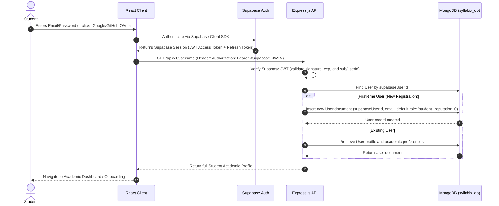
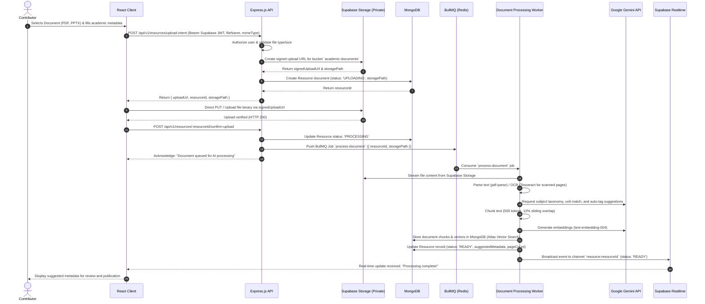
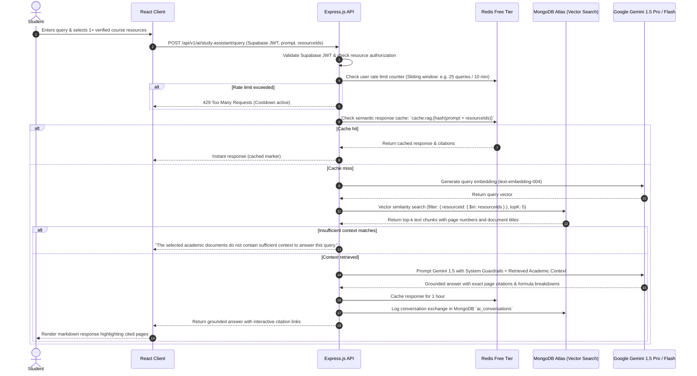
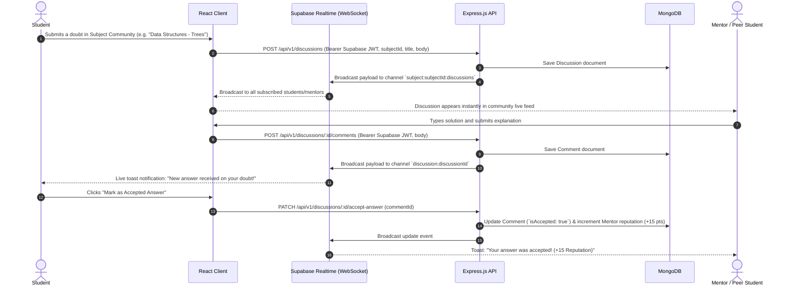

# Syllabix — Architecture & System Flow Specification

> **Document Version:** 3.0  
> **Status:** Architecture Reference & Implementation Guide  
> **Target Stack:** MERN Stack (MongoDB + Express.js + React/Vite + Node.js) + Supabase (Auth, Storage, Realtime) + Redis Free Tier + Google Gemini AI  

---

## 1. Executive Summary & Architecture Overview

**Syllabix** is an AI-powered academic knowledge and collaboration platform designed to streamline student resource discovery, document-grounded learning, syllabus-mapped study materials, and peer collaboration across universities, programs, branches, and semesters.

The architecture combines the flexibility and developer control of the **MERN stack** with the battle-tested, managed cloud primitives of **Supabase** (Auth, Object Storage, and Realtime WebSockets), backed by high-performance **Redis** caching and the **Google Gemini AI** ecosystem:

- **Core Application Backend (Express.js + Node.js):** Custom REST API service handling business logic, data validation (Zod), RBAC authorization, and asynchronous background tasks via BullMQ workers. Replaces proprietary serverless function lock-in with a portable Node.js service.
- **Primary Data Store (MongoDB):** MongoDB (or MongoDB Atlas) serves as the single source of truth for all structured academic data—hierarchies (institutions, programs, branches, subjects, units, topics), resource metadata, reviews, discussions, quizzes, flashcards, and vectorized chunk embeddings (Atlas Vector Search).
- **Authentication & User Identity (Supabase Auth):** Replaces Clerk and legacy Appwrite Auth. Provides secure email/password, social OAuth (Google, GitHub), institutional SSO, Magic Links, and multi-factor authentication (MFA). Issues standard JWTs that are seamlessly verified in Express.js middleware and synced to student profile records in MongoDB.
- **Document & Asset Storage (Supabase Storage):** Replaces Appwrite Storage. High-resilience, S3-compatible private object storage for academic documents (PDFs, PPTs, DOCX), lecture notes, past exam papers, and syllabus copies. Direct client uploads using signed upload URLs and private file downloads served through short-lived signed URLs.
- **Real-Time Engine (Supabase Realtime):** Replaces Appwrite Realtime and custom WebSocket servers. Provides high-throughput WebSocket broadcast and presence channels for community doubt discussions, live comment threads, active study group sessions, and instantaneous notification delivery.
- **Frontend & Visual Experience:** Built with **React 18/19 + Vite + TypeScript**, styled with **Tailwind CSS** and **Shadcn UI**, and enhanced with **Framer Motion** and **GSAP** for interactive 3D background canvas effects, responsive academic graphs, and smooth state transitions.
- **Caching & Rate-Limiting (Redis Free Tier):** Managed Redis (Upstash Redis / Redis Cloud) providing distributed locks (preventing duplicate document ingestion), semantic query response caching for AI answers, and sliding-window rate limiting for Gemini LLM endpoints.
- **AI & Document Intelligence Engine:** Powered by **Google Gemini API** (`gemini-1.5-flash` for high-throughput extraction/quizzes/summaries and `gemini-1.5-pro` for complex RAG synthesis, alongside `text-embedding-004`) coordinated safely through the Node.js backend.

---

## 2. High-Level Architecture Diagram

```mermaid
flowchart TB
    subgraph Client_Layer["Frontend Client (React + Vite + TypeScript)"]
        UI["UI Layer: Tailwind CSS + Shadcn UI"]
        Motion["Animation Layer: Framer Motion + GSAP 3D Background Canvas"]
        SupabaseClient["Supabase Client SDK (@supabase/supabase-js)\n• Auth & Session State\n• Direct Signed Storage Uploads\n• Realtime Subscriptions"]
        ApiClient["Axios / TanStack Query (Express REST API Client)"]
        State["State Management (Context API / Zustand)"]

        UI <--> Motion
        UI <--> State
        State <--> SupabaseClient
        State <--> ApiClient
    end

    subgraph Supabase_Cloud["Managed Cloud Services (Supabase)"]
        SupaAuth["Supabase Auth Engine\n• OAuth (Google, GitHub, SSO)\n• Email/Password & Magic Links\n• JWT Token Generation & Refresh"]
        SupaStorage[("Supabase Storage Buckets\n• Private Academic Documents (PDFs)\n• Public Avatars & Thumbnails\n• Time-Limited Signed URLs")]
        SupaRealtime["Supabase Realtime Engine (WebSockets)\n• Community Doubt Broadcasts\n• Live Comment Feeds\n• Study Room Presence"]
    end

    subgraph Backend_Layer["MERN Backend API (Node.js + Express.js)"]
        ExpressRouter["Express.js REST API Gateway"]
        AuthMiddleware["Supabase JWT Verification Middleware\n(Extracts & Validates Bearer Token)"]
        Controllers["Domain Controllers (Resources, Syllabus, Users, AI)"]
        BullMQQueue["BullMQ Background Job Queue"]
        WorkerProcess["Document Processing Worker\n(Text Extraction, OCR, Chunking, Embeddings)"]

        ExpressRouter --> AuthMiddleware
        AuthMiddleware --> Controllers
        Controllers --> BullMQQueue
        BullMQQueue --> WorkerProcess
    end

    subgraph Cache_Layer["Caching & Task Coordination (Redis Free Tier)"]
        RedisCache[("Redis (Upstash / Redis Cloud)\n• AI Query Semantic Cache\n• LLM Sliding-Window Rate Limiting\n• Distributed Job Locks (SETNX)\n• BullMQ Job State")]
    end

    subgraph Database_Layer["Primary Database & Vector Store (MongoDB)"]
        MongoDB[("MongoDB Database (Mongoose Models)\n• Users & Academic Profiles\n• Institutional Taxonomy (Branch, Subject, Unit)\n• Resource Metadata & Version History\n• Community Discussions & Quizzes")]
        VectorStore[("MongoDB Atlas Vector Search\n(Document Chunks & text-embedding-004 Embeddings)")]
    end

    subgraph AI_Engine["Google Gemini AI Intelligence"]
        GeminiLLM["Google Gemini API (1.5 Flash / 1.5 Pro)"]
        GeminiEmbed["Gemini Text Embeddings (text-embedding-004)"]
    end

    %% Client Interactions
    Client_Layer -->|1. Direct Sign-In / OAuth| SupaAuth
    Client_Layer -->|2. Direct Upload via Signed URL| SupaStorage
    Client_Layer <-->|3. WebSocket Subscriptions & Presence| SupaRealtime
    Client_Layer -->|4. Authenticated REST Calls (Supabase Bearer JWT)| ExpressRouter

    %% Backend to Supabase Integrations
    Controllers -->|Generate Upload / Download Signed URLs| SupaStorage
    Controllers -->|Broadcast Updates & Notifications| SupaRealtime

    %% Backend to Storage & Cache
    WorkerProcess -->|Download Raw Document Stream| SupaStorage
    WorkerProcess <-->|Distributed Locks & Job Coordination| RedisCache
    Controllers <-->|Rate Limit & Response Cache| RedisCache

    %% Backend to AI Engine
    WorkerProcess -->|Generate Chunk Embeddings| GeminiEmbed
    WorkerProcess -->|Store Embeddings & Text Chunks| VectorStore
    WorkerProcess -->|Generate Auto-Tags & Summaries| GeminiLLM
    Controllers -->|Generate Question Embeddings| GeminiEmbed
    Controllers -->|Vector Similarity Retrieval| VectorStore
    Controllers -->|Context-Grounded RAG Prompting| GeminiLLM

    %% Backend to Database
    Controllers <-->|CRUD Data Operations| MongoDB
    WorkerProcess -->|Update Ingestion Status & Metadata| MongoDB
```

---

## 3. End-to-End System Flows

### Flow 1: Authentication & User Provisioning (Supabase Auth + Express + MongoDB)



1. **Authentication:** Managed by Supabase Auth supporting Email/Password, Magic Link, Google, GitHub, and SAML/institutional SSO.
2. **Session Verification:** Express middleware validates the Supabase JWT using `@supabase/supabase-js` or cryptographic verification of the Supabase JWT Secret / JWKS.
3. **Identity Synchronization:** No brittle external webhooks required; profile bootstrap occurs automatically on first authenticated API handshake, persisting user profile details into MongoDB.
4. **Role-Based Access Control (RBAC):** Supported roles (`student`, `contributor`, `mentor`, `moderator`, `admin`) are verified on every Express route before processing domain logic.

---

### Flow 2: Asynchronous Resource Upload & Ingestion Pipeline



---

### Flow 3: Document-Grounded RAG (AI Study Assistant Q&A)



---

### Flow 4: Real-Time Academic Collaboration & Doubt Resolution



---

## 4. Feature-by-Feature Tech Stack & Tooling Matrix

| Feature Area | Frontend Tools & Libraries | Backend Layer (Express + Node.js) | Cloud Infrastructure (Supabase) | Caching & Queuing (Redis) | AI & Retrieval Tools |
| :--- | :--- | :--- | :--- | :--- | :--- |
| **Hero & Animated UI Experience** | **React 18/19, Vite, Tailwind CSS, Shadcn UI, Framer Motion, GSAP, Canvas 3D** | Static serving / CDN assets | N/A | N/A | N/A |
| **Authentication & User Management** | **Supabase Client SDK** (`@supabase/supabase-js`, custom Auth forms, ProtectedRoute) | **Express Auth Middleware** (`verifySupabaseToken`), MongoDB `users` collection | **Supabase Auth** (OAuth, Email/Password, Magic Link, JWT session tokens) | **Redis** for temporary token revocation blacklist | N/A |
| **Academic Resource Library** | **React Router v6, TanStack Query, Lucide React, Shadcn Table, Filter Sheet** | **Express Resources Router**, MongoDB `resources`, `resource_versions` collections | **Supabase Storage** (`academic-documents` private bucket, time-limited signed URLs) | **Redis** for hot subject/topic resource list caching | N/A |
| **AI Document Ingestion & Auto-Tagging** | **React Dropzone, Framer Motion Progress Indicators** | **BullMQ Worker** (`process-document`), Express upload-intent endpoints | **Supabase Storage** (Direct signed upload URL), **Supabase Realtime** for progress updates | **Redis** distributed locks (`SETNX`) to avoid duplicate concurrent extractions | **pdf-parse**, **mammoth**, **Tesseract OCR**, **Gemini 1.5 Flash** for metadata extraction |
| **Syllabix AI Study Assistant (RAG Q&A)** | **Markdown renderer, KaTeX (Math), Syntax Highlighter, Citation Badges** | **Express AI Router**, MongoDB `ai_conversations`, `document_chunks` | N/A | **Redis** for semantic prompt/response cache & per-user rate limiting | **Gemini 1.5 Pro / Flash**, **Gemini text-embedding-004**, **MongoDB Atlas Vector Search** |
| **AI Summaries & Revision Notes** | **Shadcn Tabs, Accordion, Export to PDF / Markdown buttons** | **Express Summaries Controller**, MongoDB `summaries` collection | N/A | **Redis** for caching precomputed summaries by resource version | **Gemini 1.5 Flash** with structured JSON output |
| **AI Question & Practice Generator** | **Interactive Quiz UI with timer, radio options, scorecards (Framer Motion)** | **Express Quiz Controller**, MongoDB `quizzes`, `quiz_attempts` collections | N/A | **Redis** for temporary quiz session state & timer sync | **Gemini 1.5 Flash** (MCQs, short-answer, and long-form schemas) |
| **AI Flashcards & Spaced Recall** | **Framer Motion 3D card flip (`rotateY: 180deg`), touch swipe controls** | **Express Flashcard Controller**, MongoDB `flashcard_decks`, `flashcards` | N/A | **Redis** for daily due-card cache | **Gemini 1.5 Flash** for Q&A definition extraction |
| **Syllabus Mapping & Coverage** | **Shadcn Tree View, Progress Bars, Heatmap indicators** | **Express Syllabus Router**, MongoDB `programs`, `branches`, `subjects`, `units`, `topics` | N/A | **Redis** caching frequently queried syllabus trees | N/A |
| **Academic Knowledge Graph** | **GSAP-powered SVG / Canvas graph visualization or React Flow** | **Express Graph Controller**, MongoDB `topics`, `concept_relations` | N/A | **Redis** for graph adjacency list caching | **Gemini 1.5 Flash** for identifying prerequisite concepts |
| **Personalized Recommendations** | **Recommendation carousel, "Because you study X" badges** | **Express Recommendations Controller** | N/A | **Redis** for cached personalized recommendation feeds | Vector similarity matching against student academic profile |
| **Resource Trust, Reviews & Moderation** | **Star ratings, Report modal, Moderator review queue** | **Express Moderation Router**, MongoDB `reviews`, `reports`, `moderation_actions` | N/A | **Redis** tracking review submission rate limits | **Gemini 1.5 Flash** for automated text sentiment & spam filtering |
| **Academic Communities & Discussions** | **Threaded comment list, Upvote buttons, Accepted answer pill** | **Express Community Router**, MongoDB `discussions`, `comments` | **Supabase Realtime** (WebSocket channels for subject and discussion broadcasts) | **Redis** for active room visitor counters | N/A |
| **Collaborative Study Groups** | **Group dashboard, Calendar schedule, Shared resource list** | **Express Study Group Router**, MongoDB `study_groups`, `study_group_members` | **Supabase Realtime Presence** (track online active participants in study rooms) | **Redis** for temporary shared whiteboard/notes | N/A |
| **Senior-Junior Mentorship** | **Mentor card catalog, Request dialog, Booking status tracker** | **Express Mentorship Router**, MongoDB `mentor_profiles`, `mentorship_requests` | **Supabase Realtime** for instant notification alerts | **Redis** rate limiting mentor requests | N/A |
| **Contribution & Gamification** | **Badges, Leaderboard tables, Animated reputation progress** | **Express Gamification Router**, MongoDB `contribution_events` | N/A | **Redis Sorted Sets (ZSET)** for lightning-fast real-time leaderboards | N/A |
| **Real-Time Notifications & Feed** | **Shadcn Popover notification bell, Toast notifications (Sonner)** | **Express Notifications Router**, MongoDB `notifications` | **Supabase Realtime** for instant push notifications to user-specific channels | **Redis** storing unread notification count counters | N/A |
| **Admin & Institution Analytics** | **Recharts / Tremor interactive charts, CSV export tool** | **Express Analytics Router**, MongoDB aggregation pipelines | N/A | **Redis** caching precalculated daily/weekly aggregate metrics | N/A |

---

## 5. UI & Styling Architecture (3D Background, Motion & Design System)

> **Design System Rule (`design.md`):**  
> All UI/UX design decisions, color tokens, typography scales, spacing, interactive component states, and accessibility rules are strictly bound to [design.md](file:///d:/syllabix/design.md). Engineers must not introduce arbitrary styling, unmapped hex codes, or off-scale pixel dimensions.

### 5.1 Design Tokens & Aesthetic Reference
- **Visual Reference:** Modeled on the [Toolfolio](https://toolfolio.com/) high-density dark-first design architecture.
- **Surface Foundations:** Pitch-black canvas (`--color-surface-base: #000000`), elevated cards (`--color-surface-muted: #080808`), interactive hover fills (`--color-surface-interactive: #141414`), hairlines (`--color-border-default: #2e2e2e`), and interactive element borders (`--color-border-interactive: #767676`).
- **Typography Stack:** `'Inter', system-ui, arial` with base weight `300`, medium `500` (buttons/active pills), and semibold `600` (headings). Size scale: `12px` (xs), `14px` (sm/base), `16px` (md), `18px` (lg), `20px` (xl), `44px` (2xl).
- **Spacing Scale:** Strict 4-step spacing (`8px`, `12px`, `16px`, `20px`). Macro layout spacing must use exact integer multiples of `20px` (`40px`, `60px`, `80px`).
- **Component 7-State Matrix:** All interactive controls (Links, Buttons, Cards, Lists, Navigation) must implement: `default`, `hover`, `focus-visible` (with `--shadow-focus`), `active`, `disabled`, `loading`, and `error`.
- **Accessibility (WCAG 2.2 AA):** Strict contrast guarantees (`color.text.tertiary` `#a6a6a6` on elevated `#080808` surfaces for `8.59:1` contrast), single stretched-link card architecture (1 tab stop per card), roving `tabindex` for filter pills, top-of-DOM skip link, and `scroll-padding-top: 80px`.

### 5.2 Animated 3D Background & Visual Hierarchy
To deliver an immersive, cutting-edge academic experience without sacrificing accessibility or device battery life:
1. **GSAP (GreenSock Animation Platform) + HTML5 Canvas:**
   - Renders a lightweight, interactive 3D particle constellation and floating geometric syllabus graph nodes in the canvas background.
   - Connected nodes react subtly to mouse cursor movement (parallax perspective) with smooth interpolation throttled via `requestAnimationFrame`.
   - Automatically pauses or reduces particle count when the browser window loses focus or when `prefers-reduced-motion` is detected.
2. **Framer Motion:**
   - Coordinates micro-interactions, layout transitions, modal reveals, accordion expands, and 3D flashcard card-flipping (`transform: rotateY(180deg)`).
   - Manages fluid page transitions between the Resource Explorer, Community Doubt Feed, and the Syllabix AI Study Assistant.
3. **Tailwind CSS + Shadcn UI:**
   - Delivers a dark-mode-first aesthetic with accessible, keyboard-navigable components built on Radix UI primitives.

---

## 6. Database Collections Schema (MongoDB / Mongoose)

```text
Database: syllabix_db (MongoDB)
├── users (supabaseUserId [indexed, unique], name, email, avatarUrl, role, institutionId, branchId, semester, reputationPoints, createdAt)
├── institutions (name, domain, state, verified, createdAt)
├── programs (institutionId, name, code, durationYears)
├── branches (programId, name, code)
├── semesters (programId, number, label)
├── subjects (branchId, semesterId, code, name, credits)
├── units (subjectId, number, title)
├── topics (unitId, title, prerequisiteTopicIds)
├── resources (ownerId, title, description, resourceType, subjectId, topicIds, storagePath, mimeType, fileSizeBytes, status, viewCount, downloadCount, isVerified)
├── resource_versions (resourceId, version, storagePath, changeNote, createdBy, createdAt)
├── document_chunks (resourceId, chunkIndex, pageNumber, textContent, embedding [1536/768 float array], metadata)
├── reviews (resourceId, userId, rating, comment, createdAt)
├── reports (resourceId, reporterId, reason, status, resolvedBy, createdAt)
├── bookmarks (userId, resourceId, createdAt)
├── discussions (subjectId, authorId, title, body, tags, status, upvotes, createdAt)
├── comments (discussionId, authorId, body, parentCommentId, isAcceptedAnswer, upvotes, createdAt)
├── study_groups (name, subjectId, ownerId, visibility, schedule, memberIds)
├── mentor_profiles (userId, expertiseSubjectIds, bio, availability, verified, rating)
├── mentorship_requests (mentorId, studentId, subjectId, message, status, createdAt)
├── quizzes (creatorId, resourceIds, subjectId, title, difficulty, questionsJson, createdAt)
├── quiz_attempts (quizId, userId, score, maxScore, answersJson, timeSpentSeconds, completedAt)
├── flashcard_decks (ownerId, title, resourceIds, subjectId, visibility, cardCount)
├── flashcards (deckId, front, back, sourceRef, interval, repetition, easeFactor, dueDate)
├── ai_conversations (userId, resourceIds, messages: [{ role, content, citations, createdAt }])
└── notifications (userId, type, payloadJson, isRead, createdAt)
```

---

## 7. Supabase Configuration & Policies

### 7.1 Supabase Auth Configuration
- **Providers:** Email/Password, Google OAuth, GitHub OAuth, Magic Links.
- **JWT Verification in Express:**
  - Client sends `Authorization: Bearer <supabase_access_token>`.
  - Express middleware validates the token using `supabase.auth.getUser(token)` or directly via `jsonwebtoken` against the project's Supabase JWT Secret.
  - Express extracts `user.id` (mapped to `supabaseUserId` in MongoDB) and attaches the verified user to `req.user`.

### 7.2 Supabase Storage Configuration
- **Buckets:**
  - `academic-documents`: **Private** bucket. Holds all uploaded syllabus copies, PDFs, lecture notes, and question papers. Direct access is denied; reads require signed URLs with an expiration TTL (e.g., 15 minutes).
  - `public-assets`: **Public** bucket. Holds user avatars, institution logos, and generated preview thumbnails.
- **Access Flow:**
  1. **Upload:** Client requests upload permission from Express -> Express generates a signed upload URL via Supabase Storage SDK -> Client uploads binary directly to Supabase Storage.
  2. **Download / Preview:** Client requests view access from Express -> Express checks user enrollment/authorization -> Express creates a time-limited signed download URL (`storage.from('academic-documents').createSignedUrl(path, 900)`) -> Client renders/downloads file safely.

### 7.3 Supabase Realtime Channels
- **Broadcast Channels:**
  - `subject:{subjectId}:discussions` — Broadcasts new doubt posts to active peers in that subject.
  - `discussion:{discussionId}` — Broadcasts live comments and answer acceptance.
  - `user:{supabaseUserId}:notifications` — Private user notifications (reputation points, replies, mentorship status).
- **Presence Channels:**
  - `study-group:{groupId}` — Tracks active students present in a collaborative study room.

---

## 8. Caching & Optimization Strategy (Redis Free Tier)

Given the constraints of a **Redis Free Tier** (e.g., Upstash with 10,000 commands/day or Redis Cloud 30MB limit):
1. **Short TTLs on Volatile Data:** AI RAG responses cached with a 1-hour TTL; syllabus hierarchy structures cached with a 24-hour TTL.
2. **Selective Key Design:**
   - `ratelimit:ai:{supabaseUserId}` — Sliding window rate limit using Redis string counters and `EXPIRE`.
   - `cache:rag:{hash(query + resourceIds)}` — Prevents redundant Gemini LLM API calls on identical student questions.
   - `leaderboard:global` — Redis Sorted Set (`ZSET`) for sub-millisecond rank retrieval without running expensive MongoDB aggregations.
   - `lock:doc_proc:{resourceId}` — Distributed lock (`SETNX` with a 5-minute timeout) preventing duplicate BullMQ worker runs on re-uploaded files.
3. **Eviction Policy:** Configured as `volatile-lru` to automatically evict expired and least-recently-used cache keys when memory limits approach.

---

## 9. Security, Privacy & Content Safety Guardrails

1. **Authentication Guard:** Every Express API route (except public discovery and auth endpoints) requires a verified Supabase JWT in the `Authorization: Bearer <token>` header. Client-side role claims are strictly rejected.
2. **Private File Isolation:** Academic documents in Supabase Storage cannot be accessed via public URLs. Downloads and PDF viewer embeds require server-validated, time-limited signed URLs.
3. **Document-Isolated Vector Retrieval:** RAG queries execute against MongoDB Atlas Vector Search strictly filtered by authorized document IDs: `{ resourceId: { $in: authorizedResourceIds } }`. Students can never retrieve context from unverified or private resources.
4. **Anti-Prompt Injection Defense:** Student-uploaded materials are treated as untrusted text. System prompts sent to Google Gemini strictly instruct the model to ignore any embedded directives or instruction overrides within extracted chunks.
5. **Rate Limiting & Cost Safeguards:** All AI endpoints (summaries, RAG questions, quiz generation) are throttled via Redis to avoid automated quota exhaustion and unexpected API costs.
6. **Copyright & Community Moderation:** Automated text moderation flags abusive language, while institution moderators utilize a dedicated dashboard to review and resolve flagged materials.

---

## 10. Phased Implementation Roadmap

* **Phase 1 (Core MERN + Supabase MVP) — [COMPLETED]:**
  - Supabase Auth integration (Email/Password, Google OAuth) with Express JWT verification middleware.
  - MongoDB user provisioning and academic taxonomy setup (Institutions, Branches, Semesters, Subjects).
  - Supabase Storage private bucket configuration with signed URL uploads and downloads.
  - Resource Explorer with filtering (Institution, Branch, Semester, Subject) and Bookmarks.
  - Responsive UI with Tailwind CSS + Shadcn UI + Framer Motion transitions strictly adhering to `design.md`.
* **Phase 2 (AI Document Intelligence & RAG) — [COMPLETED]:**
  - Ingestion worker for PDF text parsing (`pdf-parse`), sliding-window chunking, and Gemini `text-embedding-004` generation.
  - MongoDB `DocumentChunk` collection with Cosine Similarity vector search.
  - Syllabix AI Study Assistant with grounded answers, clickable page citations, and Citation Viewer Modal.
  - 3D Interactive Spaced Recall Flashcards with SuperMemo SM-2 algorithm (`rotateY: 180deg` via Framer Motion).
  - Redis Free Tier integration for sliding-window rate limiting, semantic response caching, and distributed locks.
* **Phase 3 (Interactive Visuals & Supabase Realtime Community) — [COMPLETED]:**
  - GSAP 3D interactive background canvas integration with reduced-motion fallbacks.
  - Supabase Realtime integration for live community Q&A, doubt resolution, and study group presence.
  - Study groups, real-time notifications, and mentorship request workflows.
* **Phase 4 (Scale, Gamification & Institutional Analytics) — [COMPLETED]:**
  - Contributor leaderboards with reputation points and tiered achievement badges.
  - Curriculum topic coverage & syllabus resource gap analysis.
  - Comprehensive departmental and institutional analytics dashboard.
