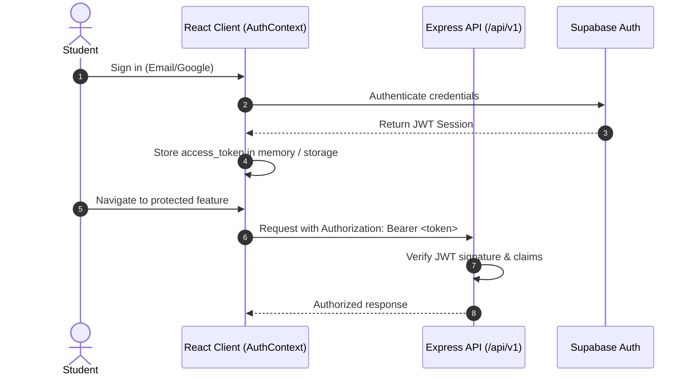
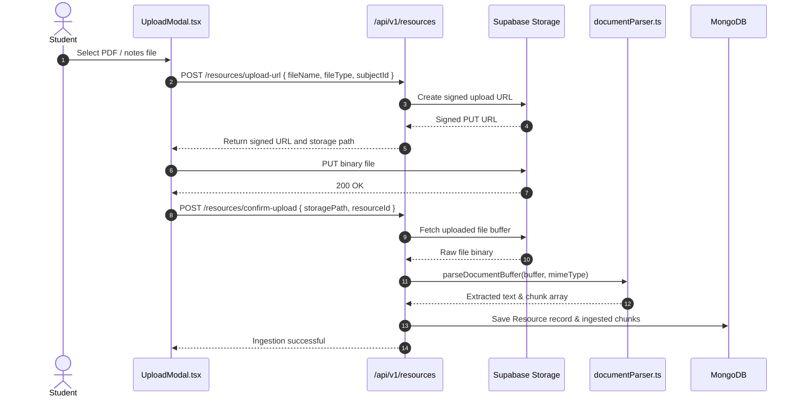
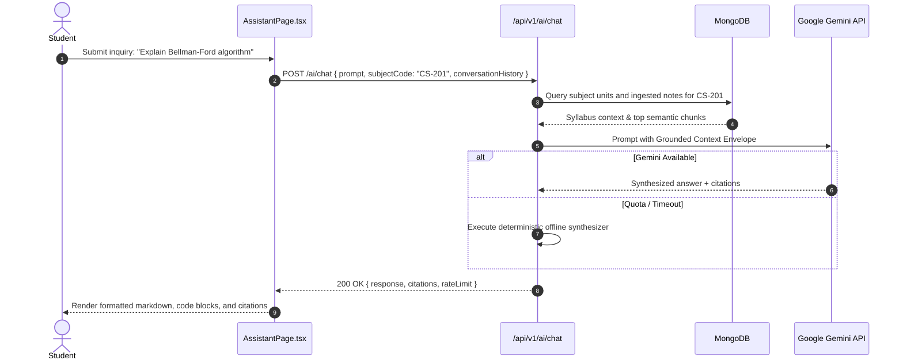
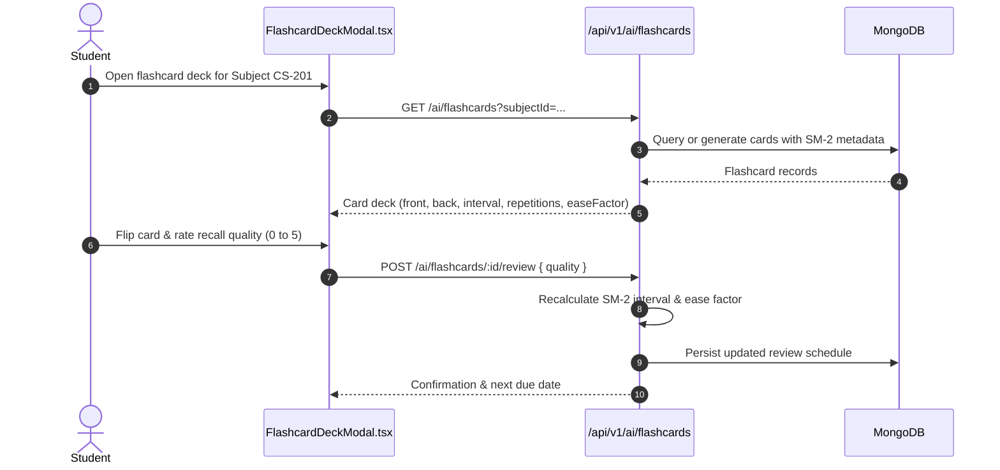

# Syllabix Data Flow Specifications

This document outlines the core data movement flows across the Syllabix system.

---

## 1. Authentication & Session Resolution Flow

---

## 2. Document Upload & Ingestion Flow

---

## 3. Grounded AI Study Assistant Request Flow

---

## 4. Spaced Repetition Flashcard Review Flow

